# plumOS-Y1

[日本語](README_JA.md) | [User Guide](docs/en/user-guide.md) | [Installation](docs/releases/v0.10.24.en.md)

[Download v0.10.24](https://github.com/game-de-it/plumOS-Y1/releases/tag/v0.10.24)

plumOS-Y1 is music-player firmware for the **Innioasis Y1 Type A**. It provides a wheel-operated music app, ten themes, USB music transfer and device settings, based on stock firmware 3.1.2 / Android 4.2.2.

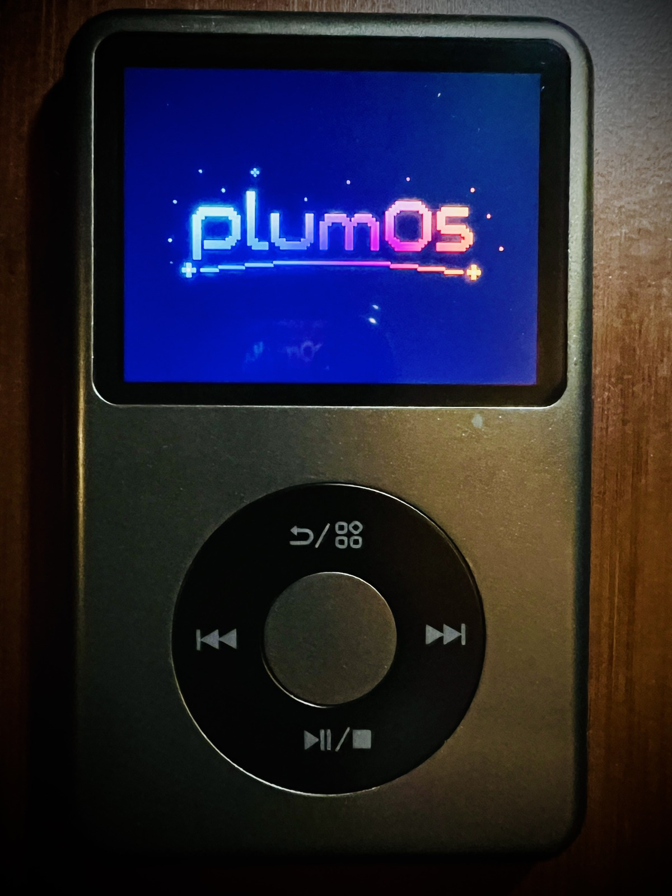

## Features

- Browse albums, songs and directories, with Japanese filenames and scrolling long titles.
- Play MP3, M4A, FLAC, WAV, Ogg, Opus and other music formats.
- Ten-band EQ, repeat/shuffle, and hold-to-seek controls.
- Ten themes inspired by music players, with font fallback for Japanese and other text.
- USB disk transfer through Finder or Windows Explorer, with background library updates.
- Bluetooth settings, brightness, click sound, vibration, FM radio and a shutdown timer.
- Install player updates from USB-copied APKs on the device; ordinary transfer and app updates need no PC ADB setup.
- English/Japanese menus and a plumOS boot logo.

## Compatibility and controls

**Innioasis Y1 Type A only. Do not use this package on Type B or Y2.**

No touchscreen or dedicated volume keys are needed. Rotate the wheel to select and press Center to confirm. Upper ring/MENU goes back, lower ring toggles playback, and left/right skips tracks. Adjust volume using the icons on the playback screen.

The app replaces the stock frontend. Stock photo, e-book, calculator and calendar screens are not included in this frontend.

## Install and update

Use the **firmware ZIP** for first installation and upgrades from earlier development firmware to 0.10.24. Back up music and confirm the hardware type before flashing.

| File | Purpose |
| --- | --- |
| `plumOS-Y1-v0.10.24-TypeA.zip` | Type A firmware with the app, device configuration and boot logo |
| `plumOS-Y1-v0.10.24-player.apk` | Player update for a device already running compatible plumOS-Y1 firmware |
| `SHA256SUMS` | Verify downloaded release files |

Follow the [Updater CE installation steps](docs/releases/v0.10.24.en.md). The APK updates only the app; use the ZIP to install or update the complete firmware.

For later player updates, copy the APK into `Updates` on the music disk, eject it on the computer, end USB sharing and select the file under **Settings → Update player**.

## Transfer music

1. Connect USB and choose **Settings → USB file transfer → Turn on USB storage** on Y1.
2. Open the disk in Finder or Windows Explorer and copy music into `Music`. Subfolders are supported.
3. Safely eject on the computer, then turn off USB storage on Y1.
4. Wait for the library update, then play from Songs, Albums or Directories.

Directory playback queues only music directly inside the selected folder. Pair and connect headphones through the device's Bluetooth settings.

## Themes

Home screens are on the left; playback screens show “Aviator” on the right. Track information and cover art are playback examples.

| Theme | Home | Now playing |
| --- | --- | --- |
| 1st Gen Monochrome | <a href="docs/images/themes/first-home.png">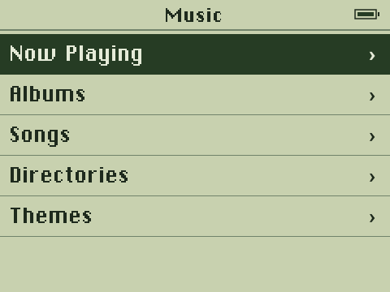</a> | <a href="docs/images/themes/first-player.png">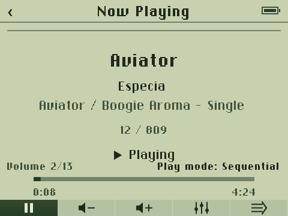</a> |
| 3rd Generation | <a href="docs/images/themes/third-home.png">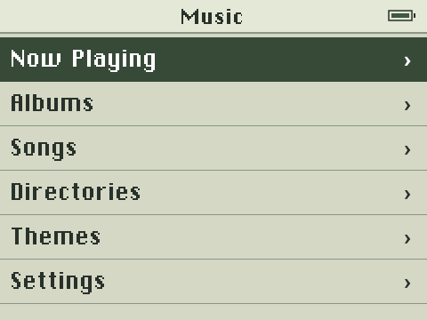</a> | <a href="docs/images/themes/third-player.png">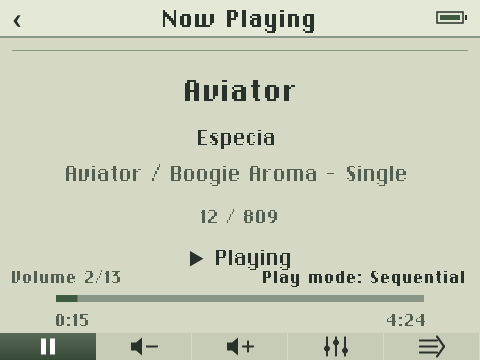</a> |
| 4th Gen / mini | <a href="docs/images/themes/gen4-home.png">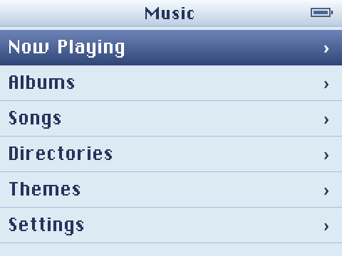</a> | <a href="docs/images/themes/gen4-player.png">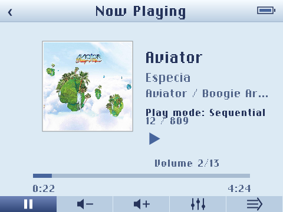</a> |
| 5th Gen Color | <a href="docs/images/themes/fifth-home.png">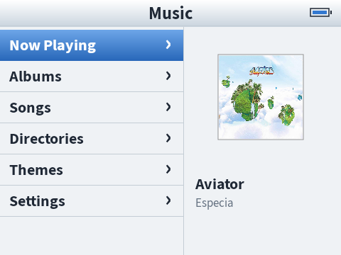</a> | <a href="docs/images/themes/fifth-player.png">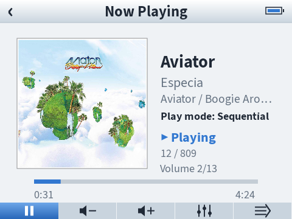</a> |
| 6th Gen / nano 3 | <a href="docs/images/themes/gen6-home.png">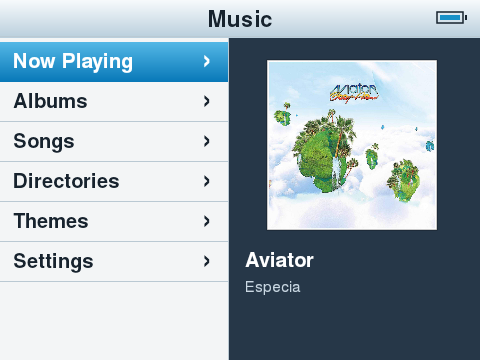</a> | <a href="docs/images/themes/gen6-player.png">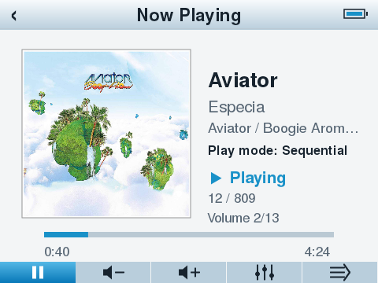</a> |
| nano 5th Gen | <a href="docs/images/themes/nano5-home.png">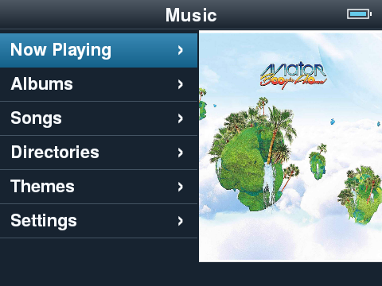</a> | <a href="docs/images/themes/nano5-player.png">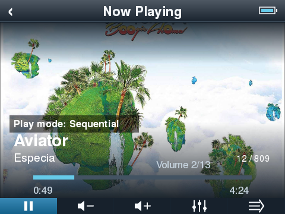</a> |
| nano 6th Gen | <a href="docs/images/themes/nano6-home.png">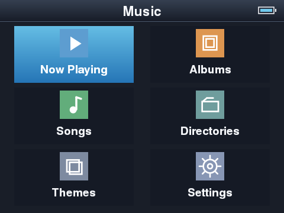</a> | <a href="docs/images/themes/nano6-player.png">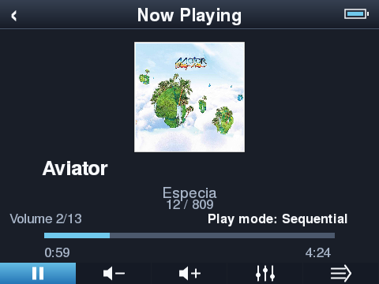</a> |
| Early touch | <a href="docs/images/themes/touch-home.png">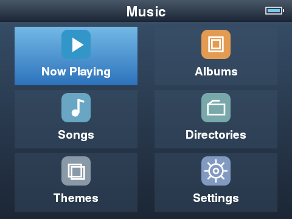</a> | <a href="docs/images/themes/touch-player.png">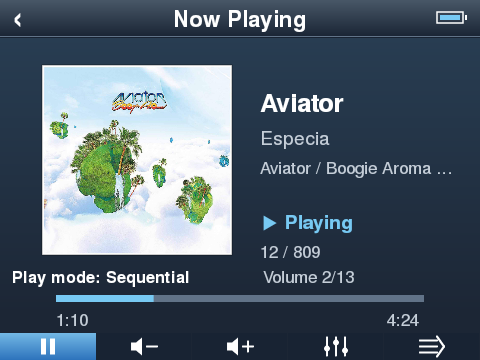</a> |
| PLUMOSAMP | <a href="docs/images/themes/winamp-home.png">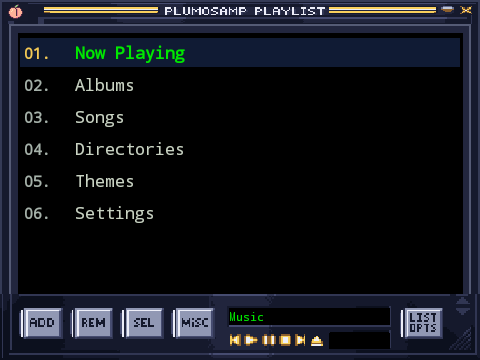</a> | <a href="docs/images/themes/winamp-player.png">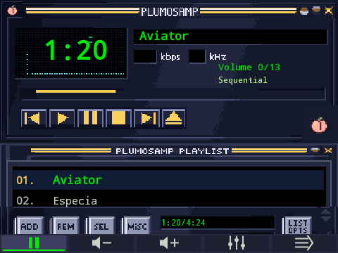</a> |
| Hi-MD MZ-DH10P | <a href="docs/images/themes/himd-home.png">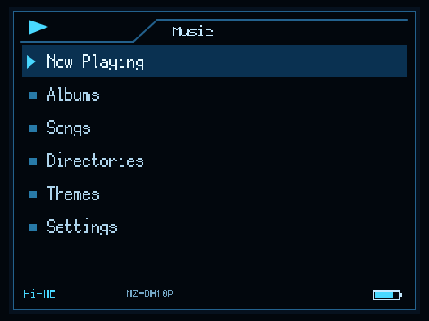</a> | <a href="docs/images/themes/himd-player.png">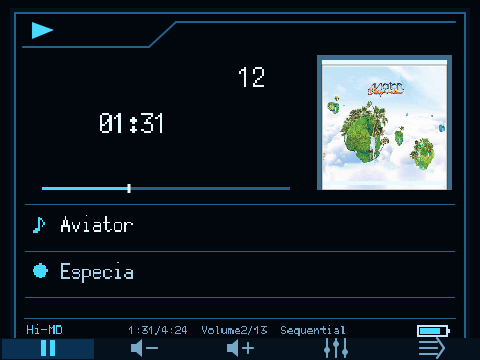</a> |

## Notes for use

- Playback support also depends on the codec inside the file.
- Strong EQ or volume boosts can distort peaks.
- Intermittent pops have been reported on speaker/wired output.
- For FM radio, turn airplane mode off and connect wired earphones as its antenna.
- If paired Bluetooth headphones are silent, check the media-audio connection in Android Bluetooth settings.

See the [User Guide](docs/en/user-guide.md) for controls, settings and recovery.

## License and further information

Original code and documentation use the [MIT License](LICENSE). Firmware and third-party material have separate terms; see [Third-Party Notices](THIRD_PARTY_NOTICES.md).

For builds, theme development and sources, see the [Developer Guide](docs/en/developer-guide.md). This is an independent community project.
