# plumOS-Y1

[English](README.md) | [ユーザーガイド](docs/ja/user-guide.md) | [インストール手順](docs/releases/v0.10.24.ja.md)

[v0.10.24をダウンロード](https://github.com/game-de-it/plumOS-Y1/releases/tag/v0.10.24)

plumOS-Y1は、**Innioasis Y1 Type A**向けの音楽プレイヤーFWです。ホイールで操作する音楽アプリ、10種類のテーマ、USBでの音楽転送、各種本体設定を利用できます。Android 4.2.2／純正FW 3.1.2をベースにしています。

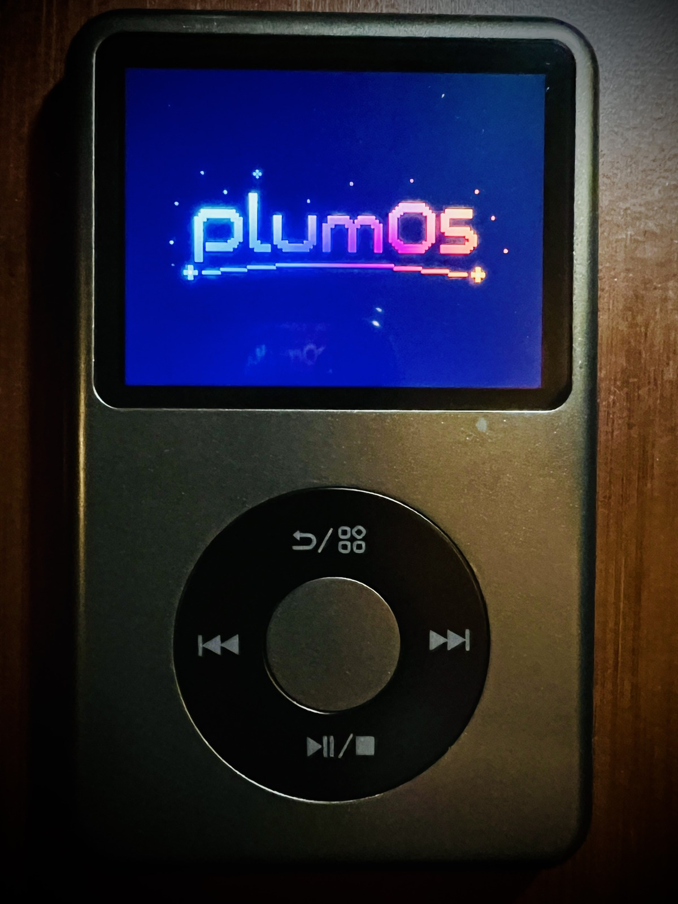

## 主な機能

- アルバム・曲・ディレクトリからの選曲。日本語ファイル名や長い曲名のスクロールに対応。
- MP3、M4A、FLAC、WAV、Ogg、Opusなどの音楽再生。
- 10バンドEQ、リピート・シャッフル、長押しでの早送り・巻き戻し。
- 歴代の音楽プレイヤーをイメージした10テーマと、日本語などのフォントフォールバック。
- Finder／Windows ExplorerからのUSBディスク転送と、バックグラウンドでの曲一覧更新。
- Bluetooth設定、画面輝度、クリック音、バイブ、FMラジオ、シャットダウンタイマー。
- USBでコピーしたAPKを本体から選んで更新。通常の転送・アプリ更新にPCのADBは不要。
- 英語・日本語のメニューと、plumOS起動ロゴ。

## 対応機種

**Innioasis Y1 Type A専用です。Type B・Y2には使用できません。**

画面タッチや独立した音量キーは不要です。ホイールで項目を移動し、中央ボタンで決定します。リング上／MENUで戻り、下で再生・一時停止、左右で前後の曲へ移動します。音量は再生画面の音量アイコンから調整できます。

純正フロントエンドに代わって本アプリが起動します。純正の写真・電子書籍・電卓・カレンダー機能は、このフロントエンドには含みません。

## インストールと更新

初回導入と旧開発FWから0.10.24への更新には、**FW ZIP**を使用してください。導入前に音楽などをバックアップし、本体のタイプを確認してください。

| ファイル | 用途 |
| --- | --- |
| `plumOS-Y1-v0.10.24-TypeA.zip` | アプリ・本体設定・起動ロゴを含むType A用FW |
| `plumOS-Y1-v0.10.24-player.apk` | 対応するplumOS-Y1 FWを導入済みの本体向けアプリ更新 |
| `SHA256SUMS` | ダウンロードした配布物のチェックサム確認 |

[Updater CEを使うインストール手順](docs/releases/v0.10.24.ja.md)に従って導入してください。APKはアプリ単体の更新用です。初回導入やFW全体の更新にはZIPを使用してください。

導入後のアプリ更新は、APKを音楽ディスクの`Updates`へコピーし、PCで取り出してUSB共有を終了した後、本体の**設定 → アプリを更新**から選びます。

## 音楽の転送

1. USBでPCに接続し、本体の**設定 → USBファイル転送 → USBストレージを開始**を選びます。
2. Finder／Windows Explorerでディスクを開き、`Music`へ音楽をコピーします。サブフォルダも使用できます。
3. PCで安全に取り出してから、本体でUSBストレージを終了します。
4. 曲一覧の更新を待ち、曲・アルバム・ディレクトリから再生します。

ディレクトリ再生では、選んだフォルダ直下の曲だけが再生対象になります。Bluetooth機器は、本体のBluetooth設定からペアリング・接続できます。

## テーマ

左はホーム画面、右は「Aviator」の再生画面です。曲情報とジャケットは再生例です。

| テーマ | TOP画面 | 再生画面 |
| --- | --- | --- |
| 初代モノクロ | <a href="docs/images/themes/first-home.png">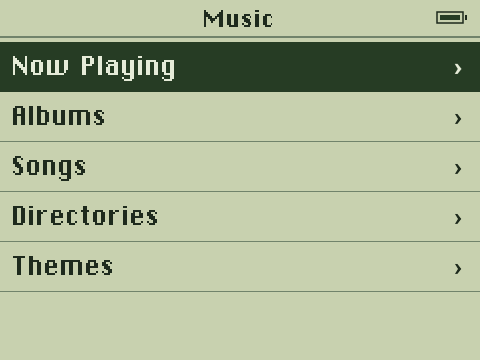</a> | <a href="docs/images/themes/first-player.png">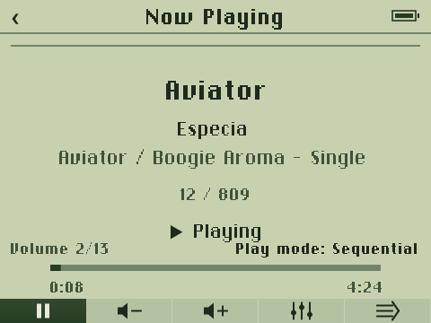</a> |
| 第3世代 | <a href="docs/images/themes/third-home.png">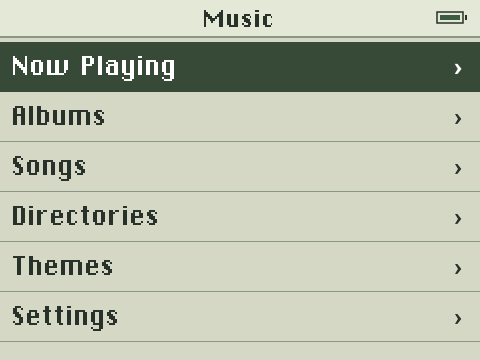</a> | <a href="docs/images/themes/third-player.png">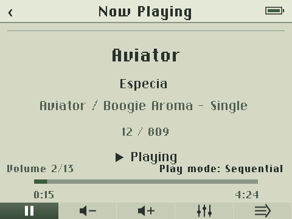</a> |
| 第4世代・mini | <a href="docs/images/themes/gen4-home.png">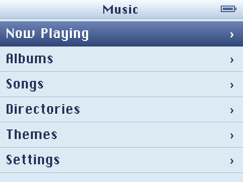</a> | <a href="docs/images/themes/gen4-player.png">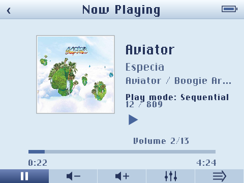</a> |
| 第5世代カラー | <a href="docs/images/themes/fifth-home.png">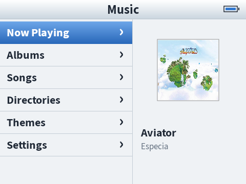</a> | <a href="docs/images/themes/fifth-player.png">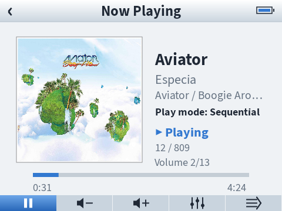</a> |
| 第6世代・nano 3 | <a href="docs/images/themes/gen6-home.png">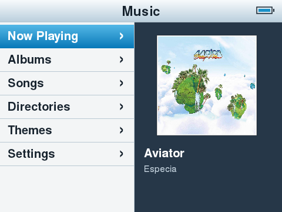</a> | <a href="docs/images/themes/gen6-player.png">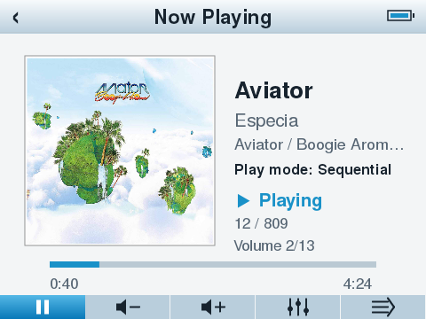</a> |
| nano 第5世代 | <a href="docs/images/themes/nano5-home.png">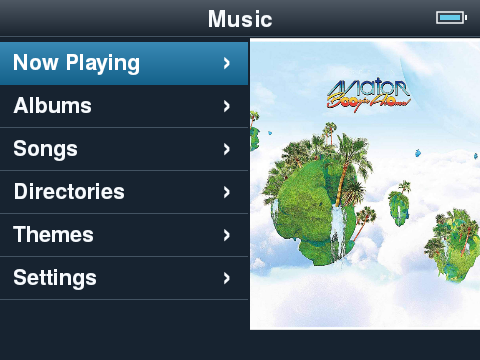</a> | <a href="docs/images/themes/nano5-player.png">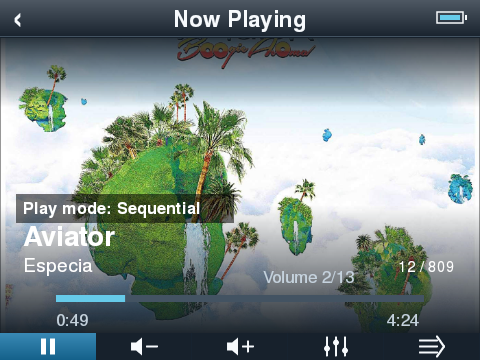</a> |
| nano 第6世代 | <a href="docs/images/themes/nano6-home.png">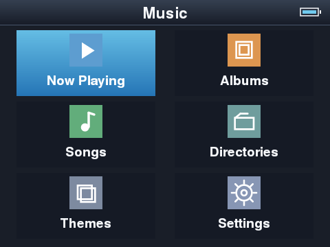</a> | <a href="docs/images/themes/nano6-player.png">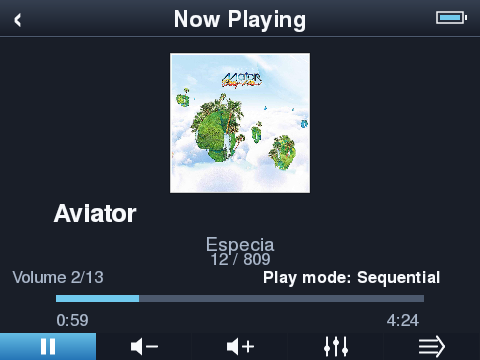</a> |
| touch 初期 | <a href="docs/images/themes/touch-home.png">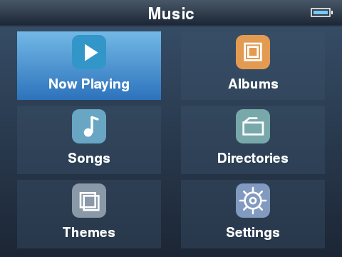</a> | <a href="docs/images/themes/touch-player.png">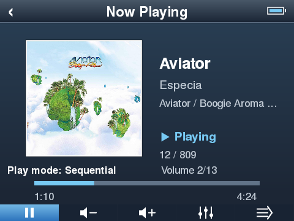</a> |
| PLUMOSAMP | <a href="docs/images/themes/winamp-home.png">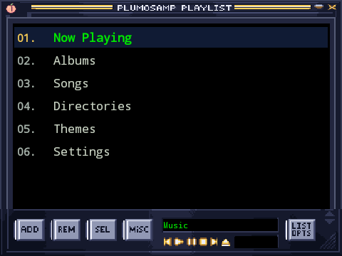</a> | <a href="docs/images/themes/winamp-player.png">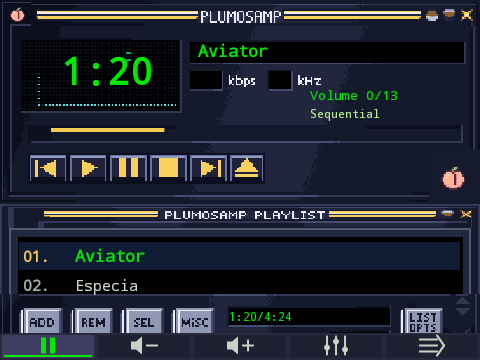</a> |
| Hi-MD MZ-DH10P | <a href="docs/images/themes/himd-home.png">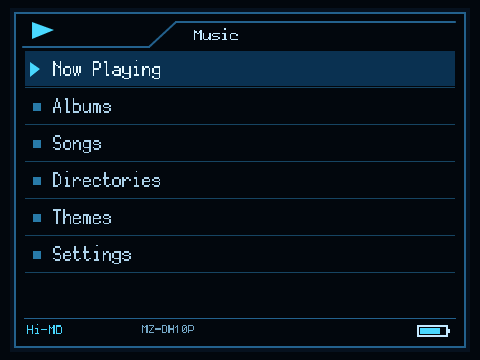</a> | <a href="docs/images/themes/himd-player.png">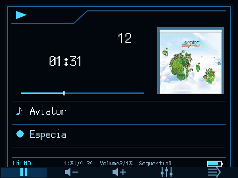</a> |

## 利用上の注意

- 再生できるかはファイル内のコーデックにも依存します。
- EQや音量ブーストを強くすると音割れすることがあります。
- スピーカー・有線イヤホンでは断続的なノイズが報告されています。
- FMラジオは機内モードをOFFにし、アンテナ用の有線イヤホンを接続して使用します。
- Bluetoothがペアリング済みでも無音の場合は、AndroidのBluetooth設定で音楽用の接続を確認してください。

操作・設定・復旧方法は[ユーザーガイド](docs/ja/user-guide.md)を参照してください。

## ライセンスと関連情報

独自コード・文書は[MITライセンス](LICENSE)です。FW全体や第三者素材にはそれぞれの条件があります。[第三者コンポーネントの表記](THIRD_PARTY_NOTICES_JA.md)を参照してください。

ビルド・テーマ開発・ソースについては[開発者ガイド](docs/ja/developer-guide.md)を参照してください。本プロジェクトは独立したコミュニティプロジェクトです。
